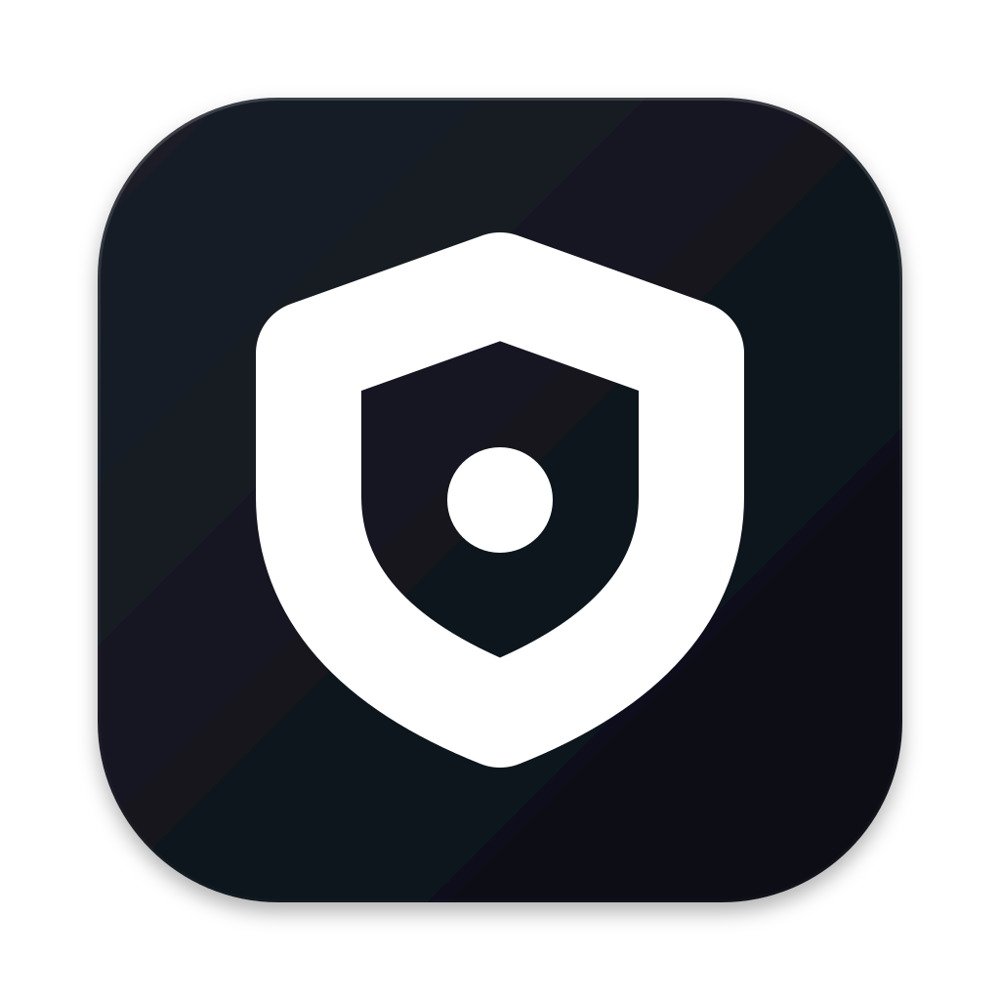
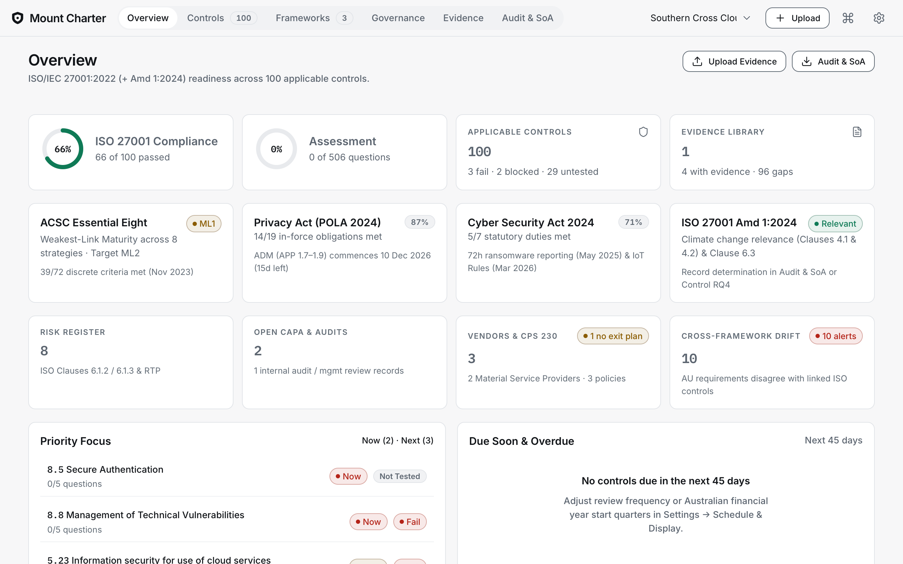
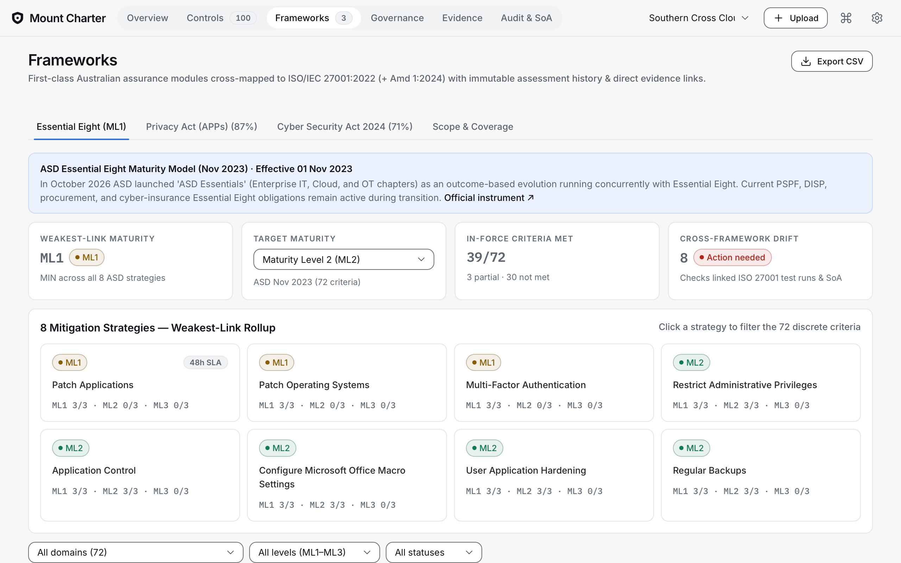
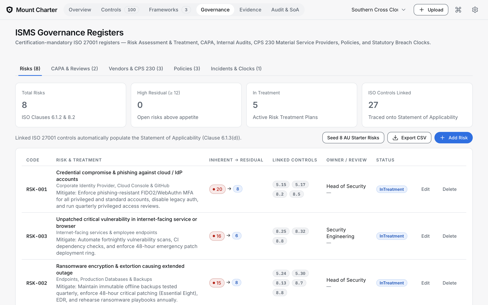
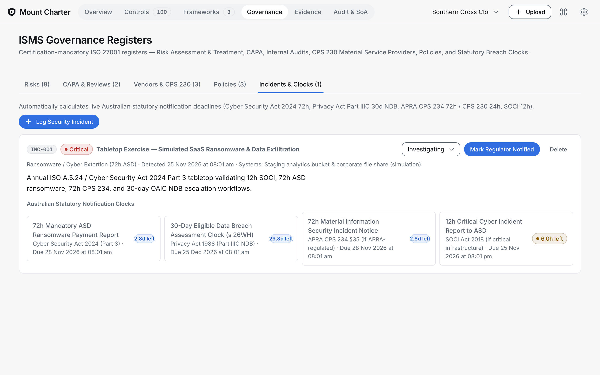
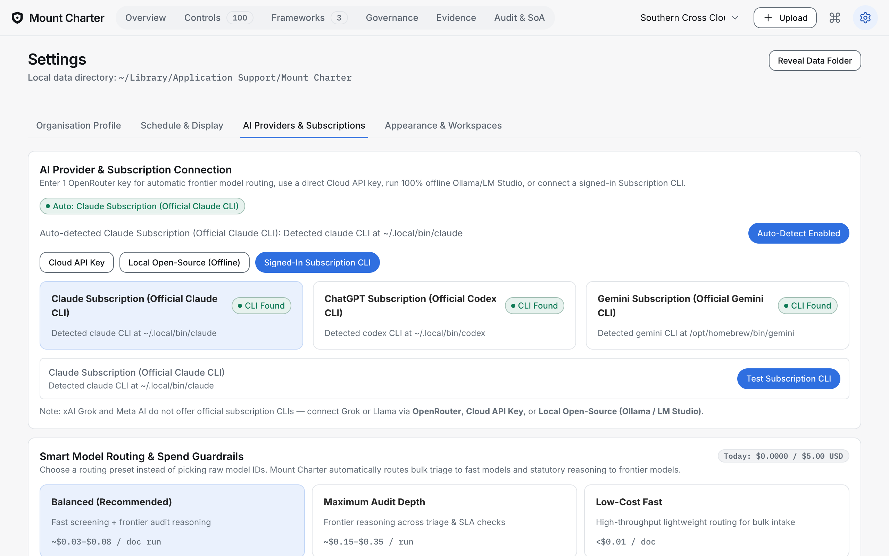
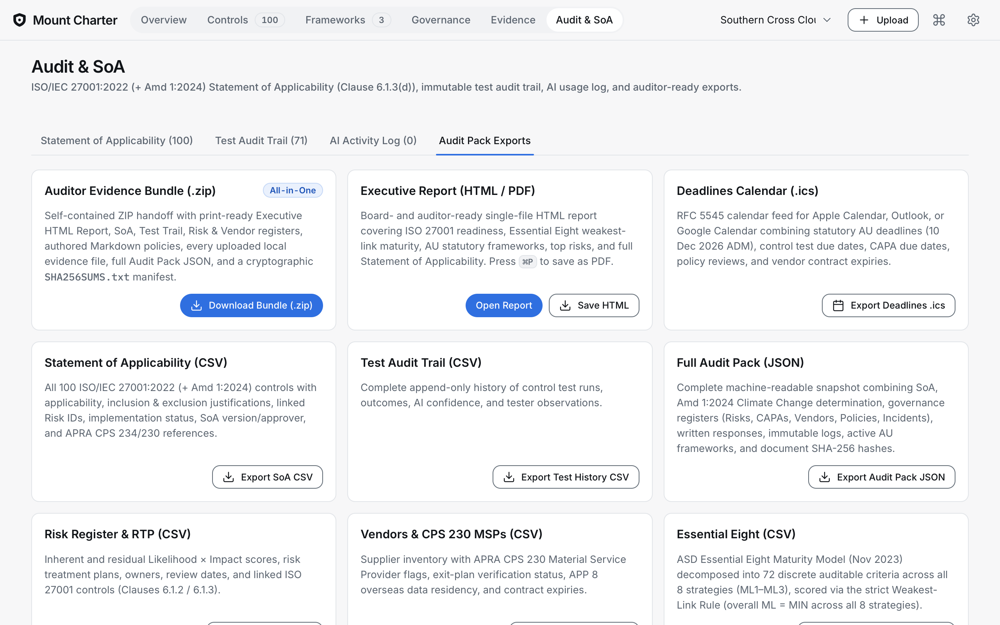
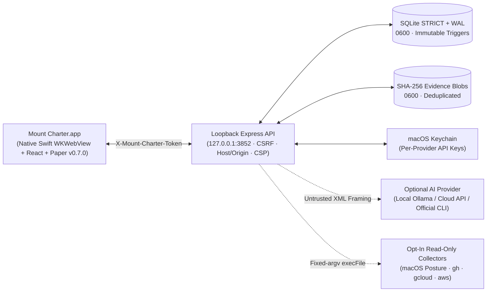

<div align="center">
  
  <h1>Mount Charter</h1>
  <p>
    <strong>Local-first ISO/IEC 27001:2022 (+ Amd 1:2024) &amp; Australian Cybersecurity / Privacy Compliance Workbench for macOS.</strong>
  </p>
  <p>
    <a href="https://github.com/haberlah/mount-charter-isms-compliance/actions/workflows/ci.yml"></a>
    <a href="https://github.com/haberlah/mount-charter-isms-compliance/releases"></a>
    <a href="LICENSE"></a>
    =22.5.0" />
    
  </p>
</div>

<p align="center">
  
</p>

---

## Why Mount Charter?

Most GRC platforms are US-centric SaaS tools (\$15k–\$40k/year) that require uploading sensitive policies, architecture diagrams, and audit findings into a vendor's cloud — while treating Australian statutory regimes as shallow spreadsheet checklists.

**Mount Charter** is built for **solo CISOs, vCISOs, security consultants, and security-sensitive Australian SMBs** who want an audit-grade, forkable workbench that runs **100% locally on macOS**:

| Capability | Typical SaaS GRC | Mount Charter (v3.0) |
| --- | --- | --- |
| **Data residency & lock-in** | Multi-tenant cloud SaaS | **100% local SQLite (`0600`) + SHA-256 blobs**; portable `.zip` backup/restore |
| **Australian statutory depth** | Generic ISO mapping | **72 discrete Essential Eight criteria** (Weakest-Link), **POLA 2024 ADM (10 Dec 2026)**, **Cyber Security Act 2024 (72h ASD)**, **APRA CPS 234 & 230**, **SOCI Act**, **NAIC AI6** |
| **Audit-trail integrity** | Editable web forms | **SQLite `BEFORE UPDATE` / `BEFORE DELETE` triggers** enforcing append-only audit logs |
| **AI privacy & flexibility** | Vendor-hosted LLM only | **Bring your own**: Cloud API Key (macOS Keychain), **100% offline Ollama / LM Studio**, or official signed-in CLIs (`claude`, `codex`, `gemini`) |
| **Auditor handoff** | Portal invite required | **One-click Auditor Evidence Bundle (`.zip`)** with print-ready Executive HTML/PDF Report, CSVs, Markdown policies, raw evidence files & `SHA256SUMS.txt` |
| **Cost & licensing** | Annual seat/connector tax | **Free, open-source MIT License** — fork, adapt, or self-host freely |

---

## Supported Standards & Legislative Register

Every framework in Mount Charter declares an **honest support tier** (`full` first-class engine vs. `ai_context_only` prompt context), authoritative Federal Register of Legislation instrument ID, effective date, and `isDraft` separation so un-enacted bills never distort in-force readiness scores. See [docs/STANDARDS.md](docs/STANDARDS.md) for full legislative citations.

| Framework | Jurisdiction | Authoritative Instrument | Support Tier | Scope |
| --- | --- | --- | --- | --- |
| **ISO/IEC 27001:2022 (+ Amd 1:2024)** | International | ISO/IEC 27001:2022 + Amd 1:2024 | First-Class Core | 100 controls (`RQ4`–`RQ10` incl. Climate & Clause 6.3 + 93 Annex A) · plain-English explainers · 262 streamlined questions · SoA |
| **ACSC Essential Eight** | Australia | ASD Maturity Model (Nov 2023) + Oct 2026 ASD Essentials note | First-Class (Weakest-Link) | 72 discrete criteria (`ML1`–`ML3`) across all 8 strategies |
| **Privacy Act 1988 & POLA Act 2024** | Australia | `C2004C00253` / `C2024A00128` | First-Class Statutory | 19 in-force obligations (incl. 10 Dec 2026 ADM `APP 1.7`–`1.9` & COPC) + 2 `isDraft` Tranche 2 watch items |
| **Cyber Security Act 2024 (Cth)** | Australia | `C2024A00098` | First-Class Statutory | 7 duties incl. 72h ransomware payment reporting & Smart Device (IoT) Rules 2025 |
| **APRA CPS 234** | Australia | `F2018L01745` | First-Class Deltas + ISO refs | 8 statutory deltas (72h incident, 10-day material weakness, tripartite testing) |
| **APRA CPS 230** | Australia | APRA CPS 230 (Effective 1 Jul 2025) | First-Class Deltas + ISO refs | 8 statutory deltas (24h disruption, critical ops tolerances, MSP exit plans) |
| **SOCI Act 2018 (+ ERP Act 2024)** | Australia | `C2018A00029` / `C2024A00100` | First-Class Statutory | 6 obligations (business-critical data, CIRMP, 12h/72h ASD reporting) |
| **NAIC Guidance for AI Adoption (`AI6`)** | Australia | NAIC Oct 2025 | First-Class + Watch | 6 essential practices + 1 `isDraft` Nov 2026 Frontier AI watch item |
| **SOC 2 Type II / EU GDPR** | Int'l / EU | AICPA TSC / Reg. (EU) 2016/679 | `ai_context_only` | Explicitly labelled as AI prompt context only (never counted as audited) |

---

## Feature Tour

### 1. Australian Frameworks, Weakest-Link Maturity & Cross-Framework Drift
Essential Eight computes strict **Weakest-Link Maturity** (`MIN` across all 8 strategies). Whenever an Australian requirement marked `Met` or `PartiallyMet` contradicts a `Fail`, `Blocked`, `Excluded`, or un-evidenced `rubric_conflict` linked ISO 27001 control, Mount Charter raises a live **Cross-Framework Drift** alert. Every requirement also supports on-demand **AI Readiness Assessment** with human-in-the-loop approval.

<p align="center">
  
</p>

### 2. Certification-Mandatory ISMS Governance Registers (`/governance`)
Everything an ISO 27001 certification auditor asks for beyond Annex A controls:
- **Risk Register & Risk Treatment Plan** (Clauses 6.1.2 / 6.1.3 / 8.2 / 8.3) with Likelihood × Impact scoring, 1-click 8-risk Australian SMB starter seeder, and M:N control links surfaced directly on the Statement of Applicability.
- **CAPA / Nonconformities** (Clause 10.2) + **Internal Audits & Management Reviews** (Clauses 9.2 / 9.3).
- **Vendors & APRA CPS 230 Material Service Providers** (A.5.19–5.22 & CPS 230) with exit-plan verification (`Missing` / `Documented` / `Tested`) and APP 8 residency tracking.
- **Policy Register & 6 Australian Starter Markdown Templates** (ISMS Policy, Access Control & MFA, Patch Management, Incident & Breach Response, Privacy & APP 1.7 ADM, Supplier & CPS 230).
- **Incident Log & Live Statutory Breach Clocks** automatically counting down 72h ASD ransomware reporting, 30-day OAIC NDB, 72h APRA CPS 234, 24h CPS 230, and 12h SOCI windows.

<p align="center">
  
</p>

<p align="center">
  
</p>

<details>
  <summary><strong>More Screenshots: Multi-Provider AI Settings &amp; Auditor Evidence Bundle Exports</strong></summary>
  <br />
  <p align="center">
    
  </p>
  <p align="center">
    
  </p>
</details>

---

## Multi-Provider AI & 100% Offline Support

AI features (document-to-question evidence matching, Persona Auditor/Advisor/Analyst reviews, and Australian framework readiness assessment) are **strictly optional** and never require a vendor subscription:

| Mode | Supported Providers | Credential / Privacy Model |
| --- | --- | --- |
| **Cloud API Key** | Anthropic (Claude), OpenAI (ChatGPT), Google Gemini, xAI (Grok), Meta Llama, Custom OpenAI-Compatible (OpenRouter, Mistral, Together, Groq, vLLM) | Stored per-provider in **macOS Keychain** (`mount-charter`); SSRF metadata-IP guard on custom endpoints |
| **Local Open-Source (100% Offline)** | **Ollama** (`127.0.0.1:11434/v1`) & **LM Studio** (`127.0.0.1:1234/v1`) with live model auto-discovery | **Zero bytes leave your Mac** — ideal for defence, health, legal, or APRA-regulated evidence |
| **Signed-In Subscription CLI** | Official `claude`, `codex`, and `gemini` CLIs (auto-detected on `PATH`) | Uses your existing authenticated CLI session with zero cookie scraping |

---

## Local-First Architecture



---

## Quick Start

### Requirements
- **Node.js `>= 22.5.0`** (uses built-in `node:sqlite`, zero native C++ addons)
- **macOS** + Xcode Command Line Tools (`swiftc`) for the native `.app` bundle and macOS Keychain *(Linux/Windows supported for browser/headless dev with `MOUNT_CHARTER_DISABLE_KEYCHAIN=1`)*

### Run Locally or Build the macOS App

```bash
# 1. Clone and install
git clone https://github.com/haberlah/mount-charter-isms-compliance.git
cd mount-charter-isms-compliance
npm install

# 2. Launch dev server (Express API + Vite HMR at http://127.0.0.1:3852)
npm run dev

# 3. Run full quality & security gates
npm run check          # TypeScript strict typecheck
npm run lint           # Biome check (--error-on-warnings)
npm test               # Critical unit, security, migration & HTTP tests
npm run drift:paper    # Verify vendored Paper v0.7.0 SHA-256 manifest
npm audit --omit=dev --audit-level=high

# 4. Build & install native /Applications/Mount Charter.app
npm run build:app
```

---

## Security & Privacy Guarantees

- **Strict code/data separation:** This repository contains generic application code, JSON schemas, and public legislative ontologies only. All user data lives strictly under `~/Library/Application Support/Mount Charter/` (`0600` SQLite + `0600` content-addressed `blobs/`, overridable via `MOUNT_CHARTER_DATA_DIR`).
- **Loopback isolation & CSRF:** Binds strictly to `127.0.0.1`, validates `Host` and `Origin` against DNS rebinding, enforces a per-launch 192-bit `X-Mount-Charter-Token` on all mutations, and serves strict `Content-Security-Policy` headers.
- **Database immutability:** SQLite `BEFORE UPDATE` / `BEFORE DELETE` triggers protect `test_runs`, `response_change_log`, and `requirement_assessment_log`.
- **Safe file & archive handling:** Magic-byte validation on uploads, formula-injection neutralisation on all CSVs, bounded zip-bomb & path-traversal protection on XLSX/ZIP parsing, and SHA-256 verification on workspace backup restores.

See [SECURITY.md](SECURITY.md) for the complete threat model and private vulnerability reporting instructions.

---

## Documentation

- [ARCHITECTURE.md](ARCHITECTURE.md) — System topology, SQLite `STRICT` schema, domain repositories, and ADRs
- [SECURITY.md](SECURITY.md) — Threat model, loopback/CSRF/CSP/SSRF/Keychain invariants, and vulnerability reporting
- [docs/STANDARDS.md](docs/STANDARDS.md) — Authoritative register of encoded standards, instrument IDs, and Nov 2026 transition notes
- [CHANGELOG.md](CHANGELOG.md) — Version history
- [CONTRIBUTING.md](CONTRIBUTING.md) — Development workflow, PR gates, and legislative ontology contribution rules
- [CODE_OF_CONDUCT.md](CODE_OF_CONDUCT.md) — Community standards

---

## Acknowledgements

Mount Charter is built in grateful acknowledgement of the subject-matter-expert (SME) inspiration and guidance that shaped the project's ISMS structure, audit-readiness philosophy, and practical focus on real-world compliance governance.

Styled with the vendored [Paper v0.7.0](https://github.com/haberlah/paper) design system.

---

## License & Legal Disclaimer

Released under the **[MIT License](LICENSE)** — free to use, fork, modify, and adapt for internal security teams or vCISO client practices.

> **Disclaimer:** Mount Charter is an operational compliance workbench designed to support structured ISMS and regulatory readiness tracking. It does **not** constitute legal advice or formal accredited certification. Organisations should verify statutory applicability and reporting obligations against the [Federal Register of Legislation](https://www.legislation.gov.au/), [ASD/ACSC](https://www.cyber.gov.au/), [OAIC](https://www.oaic.gov.au/), [APRA](https://www.apra.gov.au/), and qualified legal or audit advisers.
